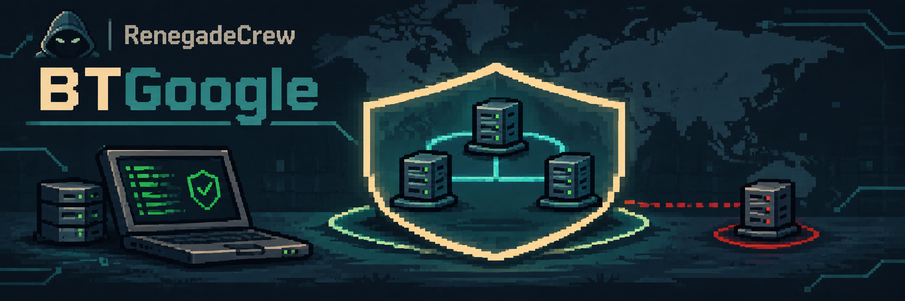

# BTGoogle



**Blue-team scope enforcement for Google Antigravity tool hooks.**

Repository: <https://github.com/renegadecrew/BTGoogle>

An agent that can run commands, fetch URLs, and write files is only as safe as
the boundary you put around it. BTGoogle is a `PreToolUse` hook that enforces a
file-based scope registry and refuses to turn every dotted identifier, file
name, or private lab address into a security prompt.

- No hidden state: authorization lives in Markdown files you can review and diff.
- No network calls: the gate is pure text matching.
- No silent widening: out-of-scope hosts prompt; explicit exclusions always win.
- Fail-open: a crashing gate logs the error and allows, instead of bricking the agent.
- Tested: 30 replication cases, all passing.

```
   agent tool call
          |
          v
   +--------------+     no network context      +---------+
   | PreToolUse   | --------------------------> |  allow  |
   |  scope gate  |                             +---------+
   +--------------+
          |  URL / network tool / host flag
          v
   +--------------+     file name, noise,      +---------+
   |  extract     | --- private address ------> |  allow  |
   |  targets     |                             +---------+
   +--------------+
          |
          v
   +--------------+     authorized by a        +---------+
   |  match vs    | --- program file --------> |  allow  |
   |  programs/   |                             +---------+
   +--------------+
          |  no program authorizes it
          v
   +--------------+
   |  force_ask   |
   +--------------+
```

## Table of contents

- [Why](#why)
- [Repository layout](#repository-layout)
- [Quickstart](#quickstart)
- [Program file format](#program-file-format)
- [Adding assets](#adding-assets)
- [Other engagements and labs](#other-engagements-and-labs)
- [Configuration](#configuration)
- [Decision log](#decision-log)
- [Verification](#verification)
- [CI and upstream monitoring](#ci-and-upstream-monitoring)
- [Design notes](#design-notes)
- [Limitations](#limitations)
- [Further reading](#further-reading)
- [License](#license)

## Why

A scope gate that flags `json.loads` as a domain, `sample.bin` as a host,
and `10.0.0.5` as an out-of-scope target is not a safety control. It is noise.
Operators learn to approve every prompt, and the one prompt that mattered is
approved with the rest.

The fix is precision, not permissiveness:

1. Extract targets only from contexts where a network target exists.
2. Keep authorization in an explicit, reviewable registry.
3. Never learn scope from the agent's own traffic. An auto-scope that
   authorizes whatever the agent touches is indistinguishable from no gate.

## Repository layout

```
BTGoogle/
├── README.md
├── LICENSE                         # MIT
├── .gitignore
├── docs/
│   ├── hook-contract.md            # Antigravity hook schema and payloads
│   ├── scope-model.md              # program files, matching, precedence
│   ├── target-extraction.md        # inspected and ignored contexts
│   ├── other-engagements.md        # recipes for web, AD, CTF, cloud, malware
│   └── troubleshooting.md          # BOM, force_ask vs ask, .htb, private IPs
├── hooks/
│   ├── scope_gate_v2.py            # the installed gate (one name, content-only)
│   ├── scope_store.py              # scope registry the installed gate reads
│   ├── scope_parser.py             # target extraction used by the registry
│   ├── scope_gate.py               # reference gate (dependency-free, test matrix)
│   ├── noise.json                  # reference domains that are never targets
│   ├── hooks.json.example          # Antigravity hook configuration
│   └── programs/
│       ├── example-program.md      # template: replace with your engagement
│       └── lab.md                  # RFC 1918 ranges and lab wildcards
├── scripts/
│   ├── pin_hook.py                 # install/verify the gate under its pinned name
│   ├── install.ps1                 # copy into ~/.gemini/config
│   ├── verify.ps1                  # send sample payloads through the gate
│   └── scope_add.py                # add assets to a program file
└── tests/
    ├── test_gate.py                # replication matrix (32 cases)
    ├── test_pin.py                 # one gate name, content-only updates
    └── payloads/
        ├── README.md
        ├── allow-in-scope.json
        ├── ask-out-of-scope.json
        └── deny-destructive.json
```

## Quickstart

Requirements: Python 3.9 or newer, PowerShell 7 (or Windows PowerShell 5.1),
and Google Antigravity with hooks enabled.

### 1. Clone and test

```powershell
git clone https://github.com/renegadecrew/BTGoogle.git
Set-Location BTGoogle
python tests/test_gate.py
```

Expected output:

```
30/30 passed
```

### 2. Install

```powershell
powershell -ExecutionPolicy Bypass -File scripts/install.ps1
```

The script installs the gate trio (`scope_gate_v2.py`, `scope_store.py`,
`scope_parser.py`) into `%USERPROFILE%\.gemini\config\hooks\`, merges
`noise.json` (a union: the list never gets shorter), copies the example
programs into `%USERPROFILE%\.gemini\config\engagements\programs\` when
they do not already exist, and merges the `hooks.json` entry in place. Other
entries keep their content, the file is backed up first and written
atomically, so Antigravity never reads a half-written configuration.

**One name, forever.** The installed gate is always
`hooks/scope_gate_v2.py`. A new fix is a change to the *content* of that
file; re-running the installer copies it over the same path. The version is
never bumped and `hooks.json` is never repointed at a `scope_gate_v3.py` — if
one ever appears, the installer stops with an error instead of quietly
running two gates. `python scripts/pin_hook.py --check` fails when the
installed copy drifts from the repository, and CI runs it on every push.

### 3. Register the hook

Merge the printed entry into `%USERPROFILE%\.gemini\config\hooks.json`:

```json
{
  "scope-gate": {
    "enabled": true,
    "PreToolUse": [
      {
        "matcher": "run_command|manage_task|read_url_content|search_web|ask_permission|write_to_file|replace_file_content|multi_replace_file_content|browser_.*",
        "hooks": [
          {
            "type": "command",
            "command": "python C:/Users/<you>/.gemini/config/hooks/scope_gate_v2.py",
            "timeout": 15
          }
        ]
      }
    ]
  }
}
```

`<you>` is a placeholder, not a literal path. Replace it with your Windows
account name. The installer merges this entry for you and prints the exact
`command` line it used; if you edit `hooks.json` by hand, copy that line
rather than typing a path. Use forward slashes in `command`. Restart
Antigravity or reload hooks, then confirm with `/hooks` in the TUI. The
full schema, including the stdin payload
and every accepted `decision` value, is in
[`docs/hook-contract.md`](docs/hook-contract.md).

### 4. Add your real scope

Replace `hooks/programs/example-program.md` with your engagement:

```markdown
# Program: acme
expires: 2027-03-31

## In-scope

*.acme.example
acme.example
203.0.113.0/24

## Out-of-scope

legacy.acme.example
```

### 5. Verify

```powershell
powershell -ExecutionPolicy Bypass -File scripts/verify.ps1
```

## Program file format

A program is a Markdown file in the programs directory:

```markdown
# Program: example-public-program
expires: 2027-01-31

## In-scope

*.example.org
example.org
10.0.0.0/8

## Out-of-scope

legacy.example.org
```

| Field | Required | Meaning |
|---|---|---|
| `# Program:` heading | No | Free-form label |
| `expires:` | No | `YYYY-MM-DD`. After that date the program is ignored |
| `## In-scope` | Yes | One asset per line |
| `## Out-of-scope` | No | One asset per line, checked before authorization |

Accepted asset forms: `example.org`, `*.example.org`, `203.0.113.10`,
`203.0.113.0/24`. A wildcard does not cover its own apex. Single-label
wildcards (`*.htb`) are accepted only for the lab TLDs `htb`, `local`, `lab`,
`test`, and `internal`.

Matching precedence is documented in
[`docs/scope-model.md`](docs/scope-model.md).

## Adding assets

`scripts/scope_add.py` appends validated assets to a program file:

```powershell
python scripts/scope_add.py example.com 203.0.113.0/24
python scripts/scope_add.py --program hooks/programs/manual.md example.com
"example.com" | python scripts/scope_add.py
```

Invalid input is rejected: a value that is not a domain, wildcard, IPv4
address, or CIDR is reported and skipped. Duplicates are not added twice.

## Other engagements and labs

The gate is scope-agnostic: it enforces whatever program files you give it. It
does not assume a bug-bounty program, a CTF, or any particular platform.

| Engagement | What changes |
|---|---|
| Web app / bug bounty | Add the program's domains and wildcards |
| Internal network / AD | Add CIDRs; enable your lab TLD with `BTG_LAB_TLDS` |
| CTF / hosted lab | Add the platform's CIDR and wildcard |
| Cloud | List specific assets; never wildcard a shared cloud domain |
| Malware / binary analysis | Local commands are allowed; add sample sources to noise |
| CVE / vendor research | Local PoCs are allowed; add reference sites to noise |

Recipes for each case, including how to enable a new lab TLD, are in
[`docs/other-engagements.md`](docs/other-engagements.md).

## Configuration

All configuration is through environment variables and files.

| Variable | Default | Purpose |
|---|---|---|
| `BTG_PROGRAMS_DIR` | `~/.gemini/config/engagements/programs` | Directory of `*.md` programs |
| `BTG_NOISE_FILE` | `~/.gemini/config/hooks/noise.json` | Reference-domain list |
| `BTG_LOG_FILE` | `~/.gemini/config/.hook_state/scope-gate.log` | JSON Lines decision log |
| `BTG_OUT_OF_SCOPE` | `force_ask` | `force_ask` (always prompt) or `ask` (respect Always-Allow) |
| `BTG_GATE_PRIVATE_IPS` | unset | `1` also gates private/loopback/link-local addresses |
| `BTG_LAB_TLDS` | `htb,local,lab,test,internal` | Extra single-label wildcard TLDs, comma-separated |

Only `force_ask` and `ask` are accepted for `BTG_OUT_OF_SCOPE`. The value is
validated so a typo cannot turn the gate into `allow`.

When the script is run from a checkout, it uses the local `hooks/programs/`
and `hooks/noise.json` unless an environment variable overrides them. When it
is installed under `~/.gemini/config/hooks/`, it uses the global directories.

## Decision log

Every decision is appended as JSON Lines:

```json
{"event": "allow", "tool": "run_command", "targets": ["example.com"], "ts": "2026-01-01T00:00:00+00:00"}
{"event": "ask", "problems": ["example.net is not covered by any program"], "text": "curl https://example.net/", "ts": "..."}
```

The file rotates to `.log.1` at 2 MB.

## CI and upstream monitoring

The CI runs regression tests on pushes and pull requests to `master`: Python 3.10 and 3.14 on Linux, plus the PowerShell smoke verifier on Windows. It uses read-only permissions and does not execute sample network commands; tests pass tool-call payloads to the gate for classification. Pushing a `v*` tag runs the same full checks and, only after they pass, publishes a GitHub Release containing a ZIP of the tagged source and a SHA-256 checksum.

Dependabot checks GitHub Actions weekly. This repository has no third-party Python packages, so a `pip` update entry would have no manifest to monitor. Dependabot keeps workflow actions current; it does not track product behavior or Google documentation changes. See [GitHub's Dependabot guide](https://docs.github.com/en/code-security/how-tos/secure-your-supply-chain/secure-your-dependencies/auto-update-actions).

A separate daily watcher compares the hook-related text in Google's [Antigravity hook contract](https://antigravity.google/docs/hooks?tab=ide) and [IDE extension changelog](https://antigravity.google/docs/changelog?ide=vscode&tab=extensions) with a reviewed baseline. A detected change opens a GitHub issue with the source and changed-content fingerprints; it does not edit code or silently accept a new baseline. After reviewing the update, refresh the baseline with:

```powershell
python scripts/check_antigravity_upstream.py --update-baseline
```

This watches the Antigravity hook interface used by BTGoogle. It does not claim to monitor Gemini model/API behavior, which this repository does not consume directly.
## Verification

`tests/test_pin.py` guards what actually ships: the installed gate keeps its
pinned name, a content update reuses it, a second version is rejected, and the
installed file still returns the same decisions (including through a BOM).

`tests/test_gate.py` runs 32 cases against `hooks/scope_gate.py`, including:

| Case | Expected |
|---|---|
| Dotted Python identifiers (`json.loads`, `urllib.request`) | `allow` |
| File names (`sample.bin`) | `allow` |
| In-scope URL | `allow` |
| Out-of-scope URL | `force_ask` |
| Bare host passed to `nmap` | `force_ask` |
| Private lab IP | `allow` |
| Public IP | `force_ask` |
| `search_web` query containing a domain | `allow` |
| `search_web` query containing a URL | `force_ask` |
| Noise-reference URL | `allow` |
| Similar but non-noise URL | `force_ask` |
| Explicit out-of-scope asset under a covering wildcard | `force_ask` |
| `*.htb` in-scope host and subdomain | `allow` |
| RFC 1918 CIDR | `allow` |
| Destructive command | `deny` |
| Paramiko dotted identifiers | `allow` |
| SSH `user@host`, including `-G`, port, or identity flags | `force_ask` when out of scope |

Last verified run: **30/30 passed**. The regression matrix includes writes to
protected hook locations using relative paths and SSH destination parsing.

## Design notes

**Context-aware extraction.** The gate inspects URLs, arguments to known
network tools, and host flags. It ignores search queries without URLs, code
identifiers, and file names. See
[`docs/target-extraction.md`](docs/target-extraction.md).

**Explicit registry.** Authorization is derived from Markdown files that a
reviewer can read and diff. There is no database and no learned state. See
[`docs/scope-model.md`](docs/scope-model.md).

**Exclusion precedence.** An explicit out-of-scope asset removes a host even
when a wildcard covers it.

**Persistence guard.** Writes to hook configuration, git hooks, shell profiles,
and agent credential files return `force_ask`, regardless of scope. Those paths
are how a single fetched page becomes code execution on every future tool call.

**Fail-open.** A crashing hook returns `allow` and logs the error. A gate that
blocks everything gets disabled in a day.

**Encoding tolerance.** `noise.json` is read as `utf-8-sig`, so a UTF-8 BOM
written by an editor does not silently disable the reference list.

## Limitations

- The gate sees the agent's command text, not the behavior of the programs it
  runs. A binary that beacons to a command-and-control server is outside the
  gate's visibility. Isolate untrusted binaries at the network layer.
- Matching is textual. No DNS resolution, no certificate validation, and no
  ownership verification.
- Scope is not inferred from conversation history. Programs are added
  explicitly with `scope_add.py` or by writing a Markdown file.
- This standalone gate does not include transcript auto-capture. That feature
  exists in richer integrations but is intentionally omitted here, because an
  auto-capture path that misreads code as a scope paste can authorize hosts
  that were never in scope.

## Further reading

- Antigravity hooks: <https://antigravity.google/docs/hooks>
- Antigravity permissions and sandbox: <https://antigravity.google/docs/permissions/>
- Antigravity browser allowlist and denylist:
  <https://antigravity.google/docs/ide/allowlist-denylist/>

## License

MIT. See [LICENSE](LICENSE).
